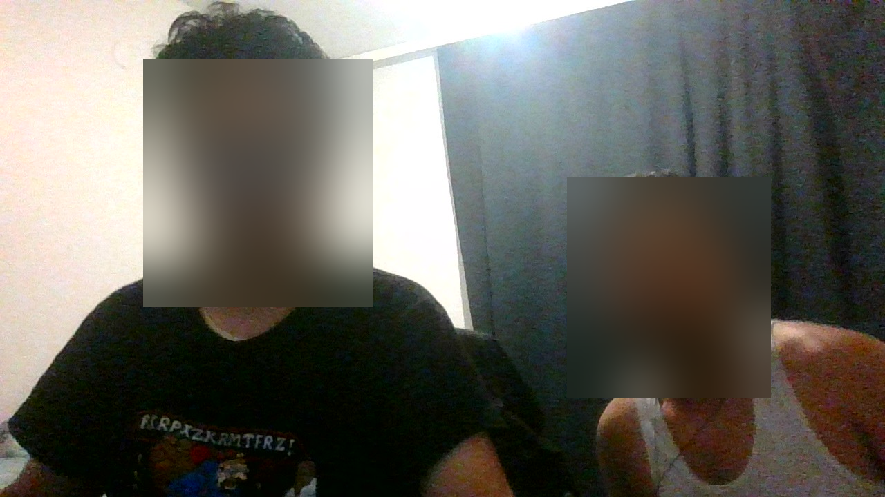
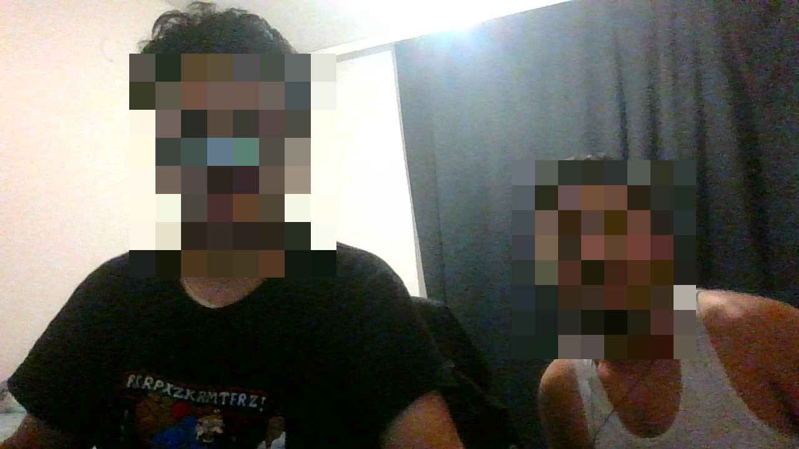
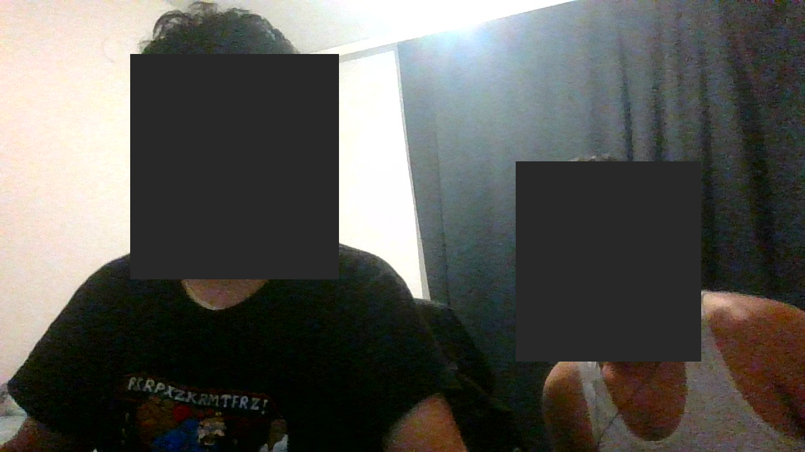
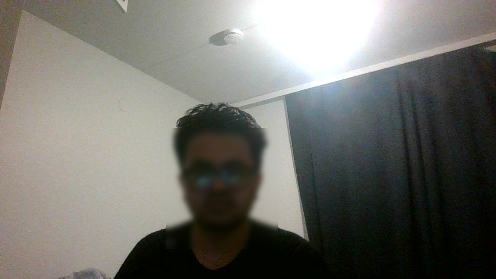
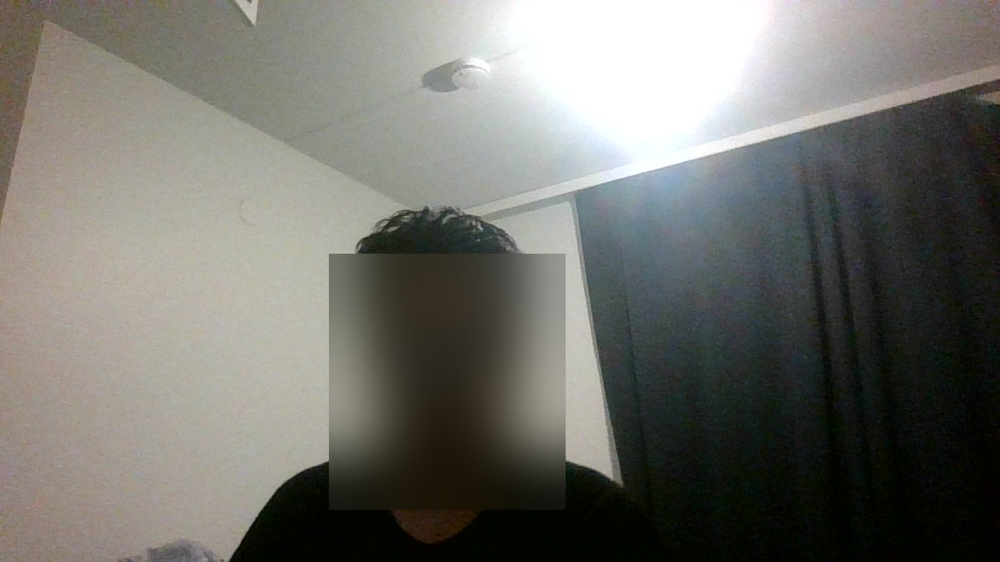

# Face Anonymizer

A Python mini-application that **detects human faces in images, video files and a live webcam stream, and anonymizes every detected face** using blur, pixelation or a solid mask.

Built for the *Applied AI Programming (TX00FM14)* course at Metropolia University of Applied Sciences.

**Demo video:** _add link here_

| Blur | Pixelate | Mask |
|---|---|---|
|  |  |  |

---

## Features

- Face detection with **MediaPipe Face Detector (BlazeFace short-range)**, a free, open-source model (Apache 2.0)
- Works on **images** (JPG, PNG, BMP, WEBP), **video files** (MP4, AVI, MOV, MKV) and a **live webcam**
- Three anonymization methods: **Gaussian blur**, **pixelation**, **solid mask**, with adjustable strength
- Handles **multiple faces** and images with **no faces** (no crash)
- **Padding** around each face box so hair, forehead, ears and jaw are covered too
- **Tiled detection** for small / distant faces
- **Flicker reduction** in video: boxes are kept for a few frames if the detector briefly misses a face
- **Debug view** (detector box, anonymized area and confidence score) and **side-by-side preview**
- **Batch processing** of a whole folder
- Processing **statistics** for video (frames, detections, speed)
- Clear **error messages** for missing files, unsupported formats, corrupt images, invalid settings and missing camera
- **Only anonymized results are saved.** Originals are never copied, uploaded or stored by the program

---

## Setup

Tested on Windows 11 with Python 3.12.10, MediaPipe 1.0.1 and OpenCV 5.0.

```bash
# 1. Get the code
git clone https://github.com/Bibas41/face-anonymizer.git
cd face-anonymizer

# 2. Create and activate a virtual environment
python -m venv .venv
.venv\Scripts\activate            # Windows
# source .venv/bin/activate       # macOS / Linux

# 3. Install the dependencies (MediaPipe also installs OpenCV and NumPy)
pip install -r requirements.txt
```

The model file `models/blaze_face_short_range.tflite` is included in the repository. If it is missing, download it:

```bash
curl -L -o models/blaze_face_short_range.tflite https://storage.googleapis.com/mediapipe-models/face_detector/blaze_face_short_range/float16/latest/blaze_face_short_range.tflite
```

> **Note:** Python 3.12 is recommended. MediaPipe 1.0 removed the old `mp.solutions` API used in many online tutorials; this project uses the current **Tasks API** (`mp.tasks.vision.FaceDetector`).

---

## Usage

```bash
# One image, default method (blur)
python anonymizer.py --input photo.jpg

# Save blur, pixelate AND mask versions, plus a debug image with detection boxes
python anonymizer.py --input photo.jpg --method all --debug

# Whole folder of images and videos
python anonymizer.py --input test_media

# Video file with a live side-by-side preview (detections left, result right)
python anonymizer.py --input clip.mp4 --show --debug

# Webcam (press q in the window to quit), optionally record the anonymized stream
python anonymizer.py --webcam --debug
python anonymizer.py --webcam --save
```

Results are saved in the `output/` folder as `<name>_<method>.png` or `<name>_<method>.mp4`.

### Options

| Option | Default | Meaning |
|---|---|---|
| `--input` | – | Image, video or folder |
| `--webcam` | – | Use the webcam instead of a file |
| `--method` | `blur` | `blur`, `pixelate`, `mask` or `all` |
| `--confidence` | `0.4` | Minimum detection confidence (lower = catches more faces, more false positives) |
| `--padding` | `0.25` | Extra margin around each face, as a fraction of its size |
| `--blur-strength` | `0.8` | Blur kernel as a fraction of face size (0.1 = weak, 1.0 = strong) |
| `--pixel-blocks` | `8` | Blocks across a face when pixelating (fewer = stronger) |
| `--tiles` | `2` | Also search an N×N grid of zoomed tiles for distant faces (0 = off) |
| `--hold` | `5` | Video: keep boxes from the last N frames to reduce flicker |
| `--show` | off | Show results in a window |
| `--debug` | off | Show/save detection boxes and confidence scores |
| `--save` | off | Webcam: save the anonymized recording |
| `--camera` | `0` | Webcam index |
| `--output` | `output/` | Output folder |

---

## How it works

```
read image / video frame
        │
        ▼
detect faces (MediaPipe BlazeFace)  ── whole frame + 2×2 zoomed tiles, duplicates merged
        │
        ▼
enlarge each box (padding) and clip to image borders
        │
        ▼
video only: add boxes from the previous 5 frames (flicker reduction)
        │
        ▼
blur / pixelate / mask each region  ──►  save or display result
```

### Face detection model

I used the **MediaPipe Face Detector** with the **BlazeFace short-range** model. It is free and open source, runs in real time on a normal laptop CPU without a GPU, installs with a single `pip` command, and is one of the recommended tools in the course material. The detector returns a bounding box and a confidence score for each face. It does **face detection, not face recognition**: it finds *where* faces are, never *who* they are, which is all anonymization needs.

I considered the **OpenCV Haar cascade** (Viola–Jones) as an alternative. It is lighter but, as the course reading and the original paper note, it struggles with side profiles, poor lighting and occlusion, which are exactly the cases that matter most for privacy.

### Design decisions

- **Padding (25%, extra at the top).** BlazeFace boxes are tight, roughly eyebrows to chin. Without padding, the hairline, ears and jaw stay visible, and these can be enough to recognize someone.
- **Confidence threshold 0.4 instead of MediaPipe's default 0.5.** In anonymization, a **missed face (false negative) is worse than blurring something that isn't a face (false positive)**. Testing showed a real case where the default missed a face (see below).
- **Tiled detection.** The short-range model shrinks the whole frame to 128×128 pixels, so a face 3 m away becomes only a few pixels and is missed. The frame is additionally split into 4 overlapping tiles; each tile is enlarged by the model, making distant faces detectable. Duplicate detections are merged with non-maximum suppression.
- **Flicker reduction.** In video, boxes from the last 5 frames are also anonymized, so a face that is missed for a frame or two (motion blur, head turning) stays covered.
- **Blur scales with face size.** A fixed-size blur kernel would leave large, close-up faces recognizable. For speed, the face region is shrunk, blurred and scaled back up, which looks the same as a very large kernel but is many times faster.
- **Video codec.** Output is written as H.264 when available (plays in browsers and VS Code), otherwise it automatically falls back to MPEG-4 (mp4v).

---

## Anonymization methods: are they irreversible?

| Method | How it works | Irreversible? |
|---|---|---|
| **Solid mask** | Replaces every pixel of the face with one colour | **Yes.** The original pixels are deleted; nothing remains to recover. |
| **Pixelation** | Shrinks the face to 8×8 blocks, then enlarges it | **Mostly.** Most detail is destroyed, but 64 average colours remain. With coarse blocks, recognition by humans or AI "depixelation" models can sometimes still partly succeed. |
| **Gaussian blur** | Averages each pixel with its neighbours | **Not guaranteed.** Blur is a mathematical filter; a weak blur can be partly reversed (deconvolution) or still recognized by eye. A strong blur removes most detail but is still a *risk reduction*, not a guarantee. |

**Weak vs strong blur (tested):**

| Weak blur (`--blur-strength 0.1`) | Strong blur (default `0.8`) |
|---|---|
|  |  |
| Hair shape, glasses, face outline and skin tone still visible: **the person is recognizable** | No identifying detail left |

As the European Commission guidance notes, data is only truly anonymous if the person can no longer be identified. **For the strongest privacy, use `--method mask`.** Blur and pixelation should be described as reducing identification risk.

---

## Testing

All test media was recorded by me for this project, with the consent of everyone shown (see *Privacy and ethics*). Tests were run on a laptop CPU (no GPU).

### Still images

| Test image | Condition | Faces expected | Faces detected | Confidence | Result |
|---|---|---|---|---|---|
| `single_face.jpg` | Close, frontal, normal light | 1 | 1 | 0.95 | ✅ |
| `multiple_faces.jpg` | Two people | 2 | 2 | 0.96, 0.93 | ✅ |
| `no_face.jpg` | Desk and bed, no people | 0 | 0 | – | ✅ no crash, no false positive |
| `side_look.jpg` | Head turned sideways | 1 | 1 | 0.86 | ✅ padding covers ear and hair |
| `dark.jpg` | Lights dimmed | 1 | 1 | 0.83 | ✅ |
| `sunglasses_hat.jpg` | Sunglasses + beanie | 1 | 1 | 0.67 | ✅ lower confidence |
| `far_backlit.jpg` | ~3 m away, bright light behind | 1 | 1 | 0.46 | ✅ but only just above threshold |

### Settings comparison: a real false negative

`far_backlit.jpg` was processed with **MediaPipe's default settings** (confidence 0.5, no tiles):

```
python anonymizer.py --input test_media\far_backlit.jpg --confidence 0.5 --tiles 0 --debug
[IMAGE] far_backlit.jpg: 0 face(s) detected
```

**The face was missed and stayed fully visible.** With the project's settings (confidence 0.4 + tiles) it was detected and blurred. This is the main reason for the lower threshold and the tiling.

### Video: `two_people.mp4` (1280×720, 19 FPS, 140 frames, two people 2–4 m from the camera)

| Setting | Frames with a detection | Detections | Max faces / frame | Speed |
|---|---|---|---|---|
| Whole frame only (`--tiles 0`) | 102 / 140 | 144 | 3 | 36.6 FPS |
| Whole frame + 2×2 tiles (default) | **137 / 140** | 283 | 5 | 15–16 FPS |

- **Without tiles**, the second person's face was clearly **visible in several moments** (false negatives), because the faces were too small for the short-range model.
- **With tiles**, both faces were covered in every frame I checked. The 3 frames without a detection are when both people have their backs to the camera, so there was no face to hide.
- Even with tiles, processing (15–16 FPS) is close to the video's own frame rate.

### Webcam

Live test with the laptop's built-in camera (`--webcam --debug`, tiles enabled):

- Ran in **real time at 29.7 FPS** on the laptop CPU.
- Facing the camera, the face was detected with confidence **0.97**, and the padded box covered hair and ears.
- I tested **turning my head left and right, leaning back, moving close to the camera, covering part of my face with my hand, and fast head movements**. In the screen recording of the test, the face stayed covered in the frames I reviewed; moving close simply produced a larger box.
- The **T-shirt print** was occasionally detected as a second face, the same false positive as in the video test.
- The printed session statistics (28,963 frames, 8,268 with a face) include a long period when I was away from the camera, so only the speed figure is meaningful from that run.

### Error handling

| Test | Command | Output |
|---|---|---|
| Corrupt image | `--input error_tests` (`broken.jpg` is a text file) | `[ERROR] Could not read image (corrupt or unsupported)` |
| Unsupported format | `--input error_tests` (`notes.txt`) | `[SKIP] Unsupported file type: notes.txt (supported: ...)` |
| Missing file | `--input test_media\does_not_exist.jpg` | `[ERROR] Input not found` |
| Invalid setting | `--confidence 5` | `[ERROR] --confidence must be between 0 and 1` |
| Missing camera | `--webcam --camera 5` | `[ERROR] No camera found at index 5. Is it connected and not used by another app?` |
| No face in image | `no_face.jpg` | Warning printed, file saved unchanged, no crash |

In every case the program printed a clear message and did not crash.

### False positives and false negatives

- **False negatives (missed faces)** are the more serious error, because they leave a person identifiable. Observed causes: **small, distant faces** (fixed with tiling and a lower threshold), and **fast movement or head turns** in video (reduced by keeping boxes for 5 frames). Faces turned fully away are not detected, which is correct since no face is visible.
- **False positives (non-faces blurred)** are less harmful. Observed: **a cartoon face printed on a T-shirt** was sometimes detected as a face (confidence around 0.4–0.5), and for distant faces the whole-frame pass sometimes returned **oversized boxes**, blurring part of the background. I chose to keep these: blurring too much is better than blurring too little.
- Lowering the threshold trades more false positives for fewer false negatives. For a privacy tool, that is the right direction.

---

## Limitations

- The **short-range model** is designed for faces within about 2 m. Tiling helps up to roughly 3–4 m; very small faces in crowds or wide shots may still be missed. A full-range model or a larger detector (e.g. RetinaFace, YuNet) would improve this.
- **Faces in profile beyond ~90°, heavily occluded or strongly motion-blurred** can be missed for single frames.
- **Blur and pixelation are not guaranteed to be irreversible**; only the mask method fully removes the face.
- Only the **face** is anonymized. People can still be identified by **clothing, tattoos, body shape** or the **surroundings**. (Output videos have no audio track, so voices are removed.)
- Tiling makes video processing about 2–3× slower; use `--tiles 0` for faster webcam use when people are close to the camera.
- Every output should still be **checked by a human** before it is shared.

---

## Privacy and ethics

- **Test media:** all photos and videos were recorded by me specifically for this project. The second person gave consent to be recorded and to appear in the test material and demo.
- **Originals are not published.** The `test_media/` folder (original photos/videos) and `output/` folder (which contains debug images showing un-anonymized faces) are excluded from this repository with `.gitignore`. Only anonymized example images are included.
- **No storage of originals by the program.** Media is processed in memory; only the anonymized result is written to disk. Webcam frames are not saved unless `--save` is used, and then only the anonymized version.
- **Everything runs locally.** No image is uploaded to any online service.
- **Detection, not recognition.** The program never tries to identify anyone. Under the GDPR (Art. 4(14)), facial images processed to uniquely identify someone are biometric data; this project does the opposite and removes identifying information.
- **Honest limitations.** The tool reduces identification risk but does not guarantee legal anonymity; see *Limitations*.

---

## Project structure

```
face-anonymizer/
├── anonymizer.py          # the application
├── requirements.txt       # Python dependencies
├── models/
│   └── blaze_face_short_range.tflite   # MediaPipe face detection model
├── examples/              # anonymized example outputs used in this README
├── README.md
└── .gitignore             # keeps test_media/, output/ and .venv/ out of Git
```

---

## Sources

- MediaPipe Face Detector documentation: https://ai.google.dev/edge/mediapipe/solutions/vision/face_detector
- MediaPipe Face Detector Python guide: https://ai.google.dev/edge/mediapipe/solutions/vision/face_detector/python
- MediaPipe FaceDetector Python API reference: https://ai.google.dev/edge/api/mediapipe/python/mp/tasks/vision/FaceDetector
- Bazarevsky et al., *BlazeFace: Sub-millisecond Neural Face Detection on Mobile GPUs* (2019): https://arxiv.org/abs/1907.05047
- Liu et al., *SSD: Single Shot MultiBox Detector* (2016): https://arxiv.org/abs/1512.02325
- Viola & Jones, *Rapid Object Detection using a Boosted Cascade of Simple Features* (2001): https://www.cs.cmu.edu/~efros/courses/LBMV07/Papers/viola-cvpr-01.pdf
- OpenCV image filtering (blur) tutorial: https://docs.opencv.org/4.13.0/d4/d13/tutorial_py_filtering.html
- OpenCV drawing functions: https://docs.opencv.org/4.12.0/dc/da5/tutorial_py_drawing_functions.html
- OpenCV video writing: https://docs.opencv.org/4.12.0/d7/d9e/tutorial_video_write.html
- OpenCV cascade classifier tutorial: https://docs.opencv.org/4.11.0/db/d28/tutorial_cascade_classifier.html
- European Commission, Application of the GDPR: https://commission.europa.eu/law/law-topic/data-protection/information-business-and-organisations/application-gdpr_en
- GDPR full text (Regulation (EU) 2016/679): https://eur-lex.europa.eu/legal-content/EN/TXT/?uri=CELEX%3A32016R0679

**AI assistance:** As encouraged in the course, I used an AI assistant (Claude) to help write and debug the code and structure this README. The testing, test media, observations and design choices about thresholds and trade-offs were made and verified by me.
